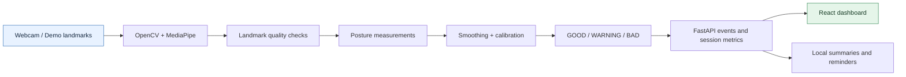

<div align="center">

# ErgoVision

**Privacy-first, real-time posture monitoring that runs locally on your computer.**

[](https://github.com/krutharth-dev/Ergo-Vision/actions/workflows/ci.yml)
[](LICENSE)
[](https://www.python.org/)
[](https://react.dev/)

ErgoVision uses OpenCV and MediaPipe to estimate ergonomic posture indicators from a webcam, then presents live feedback, session metrics, and a posture score in a local React dashboard.

**Ergonomic guidance only. ErgoVision is not a medical device and does not provide diagnosis or treatment.**

</div>

## At a glance

| | |
|---|---|
| **Purpose** | Real-time webcam-based ergonomic posture feedback |
| **Stack** | Python, FastAPI, OpenCV, MediaPipe Tasks, React 19, TypeScript and Vite |
| **Runs on** | Local macOS or Windows computer with a webcam |
| **Privacy** | On-device inference; no application-uploaded camera footage |
| **Modes** | Webcam and webcam-free demo mode |
| **Project maturity** | Student-friendly local application; ergonomic aid, not clinical assessment |

### How it works



See [illustrated workflows](docs/WORKFLOWS.md) for the camera lifecycle, installation paths and validation checklist.

## Highlights

- Local webcam processing with no cloud inference
- Face and pose landmark analysis with MediaPipe Tasks
- Tracking-confidence gating so weak landmarks do not produce false GOOD scores
- Guided camera framing with head / shoulder / hip visibility checks
- Runtime camera selection for built-in and external webcams
- Head tilt, shoulder alignment, neck offset, forward-head, gaze and torso indicators
- Calibrated slouch / hunch detection using shoulders, hips and relative pose depth
- Personal neutral-posture calibration stored locally on the computer
- 0–100 posture score with GOOD / WARNING / BAD states
- Live annotated camera stream
- Actionable posture feedback
- Session timing, posture percentages, warning counts and average score
- Live two-minute posture trend chart
- Local browser session-history summaries
- Configurable movement-break and sustained-poor-posture reminders
- Optional desktop notifications with explicit browser permission
- Installable macOS `.app` launcher and Windows Desktop/Start Menu shortcuts
- Pause, resume and reset controls
- Demo mode for development without a webcam
- Automatic MediaPipe model provisioning
- Single-server production mode after the frontend build
- macOS setup, diagnostics and safe shutdown scripts
- Backend tests and frontend build validation in GitHub Actions

## Download and install

ErgoVision supports **macOS and Windows**. Camera processing and posture inference stay on the local computer.

### macOS

The easiest route is the `ErgoVision-macOS.zip` asset from **GitHub Releases**. Extract it and double-click `install-mac.command`. ErgoVision installs under `~/Library/Application Support/ErgoVision` and creates `~/Applications/ErgoVision.app`.

For a source checkout:

```bash
bash scripts/setup_mac.sh
bash scripts/install_mac_app.sh
```

### Windows

Download `ErgoVision-Windows.zip` from **GitHub Releases**, extract it, open PowerShell in that folder, and run:

```powershell
powershell -ExecutionPolicy Bypass -File .\install-windows.ps1
```

The Windows installer copies ErgoVision to `%LOCALAPPDATA%\ErgoVision`, installs Python dependencies, creates Desktop and Start Menu shortcuts, and opens the local dashboard. Release ZIPs contain the built frontend and MediaPipe models, so Node.js is not required for a normal release install.

Windows users need **Python 3.11 or 3.12** and camera access enabled under **Settings → Privacy & security → Camera**.

See [Installation](docs/INSTALLATION.md) and [Windows](docs/WINDOWS.md) for full instructions.

### Camera privacy

The webcam activates when the first ErgoVision dashboard connects and is released when the final ErgoVision tab/window closes. The local backend can remain running without holding camera access.


## Quick start on macOS

Prerequisites: Python 3.11+, Node.js 18+, Git and a webcam.

```bash
git clone https://github.com/krutharth-dev/Ergo-Vision.git
cd Ergo-Vision
bash scripts/setup_mac.sh
bash scripts/run_mac.sh
```

ErgoVision opens at `http://127.0.0.1:8000`.

On the first camera run, macOS may ask Terminal or Python for camera access. Allow it under **System Settings → Privacy & Security → Camera**.

To stop ErgoVision, use **Ctrl+C**. The launcher also handles **Ctrl+Z** defensively so the webcam is released instead of leaving a suspended process behind.


## Install the macOS launcher

After normal setup, create a clickable local app:

```bash
bash scripts/install_mac_app.sh
```

It installs `~/Applications/ErgoVision.app`. Open it from Finder or Spotlight. To stop the backend explicitly, run `bash scripts/stop_mac.sh`. See [macOS App Launcher](docs/MAC_APP.md).

## Repository layout

```text
Ergo-Vision/
├── backend/                 FastAPI, computer vision and ergonomics engine
│   ├── app/
│   │   ├── api/             REST and WebSocket interfaces
│   │   ├── ergonomics/      geometry, measurements, classification and scoring
│   │   ├── session/         in-memory session tracking
│   │   └── vision/          camera, landmarks and MediaPipe model handling
│   └── tests/               backend unit and integration tests
├── frontend/                React + Vite + TypeScript dashboard
├── docs/                    architecture, API, model, privacy and troubleshooting
├── scripts/                 setup, run, diagnostics and validation helpers
└── .github/                 CI, Dependabot and contribution templates
```

## Requirements and compatibility

| Requirement | Release installation | Development from source |
|---|---|---|
| Python | 3.11 or 3.12 | Compatible Python 3.11/3.12 recommended |
| Node.js | Not needed when bundled frontend is present | Node.js per Vite compatibility requirements; check `frontend/package.json` |
| Webcam | Required for real monitoring | Optional with `DEMO_MODE=1` |
| Camera permission | Required for live monitoring | Required for live monitoring |
| Internet | Usually needed for initial installation | Needed for dependency/model provisioning |

The backend uses separate pinned computer-vision dependency stacks for Intel macOS and other supported platforms. Check [backend requirements](backend/requirements.txt) rather than installing MediaPipe or OpenCV versions manually.

## Development

Create the environment and install dependencies:

```bash
bash scripts/setup_mac.sh
```

Backend development server:

```bash
source .venv/bin/activate
cd backend
python -m uvicorn app.main:app --reload --port 8000
```

Frontend development server, in a second terminal:

```bash
cd frontend
npm run dev
```

Open `http://127.0.0.1:5173`.

### Demo mode

Demo mode runs the complete posture pipeline with simulated landmarks and does not require a webcam or MediaPipe model files.

```bash
cd backend
DEMO_MODE=1 python -m uvicorn app.main:app --reload --port 8000
```

## Validation

Run the full local check:

```bash
bash scripts/check.sh
```

Or run each part separately:

```bash
cd backend
python -m pytest tests/ -v
```

```bash
cd frontend
npm run build
```

GitHub Actions repeats the backend and frontend checks on every push and pull request.

## Diagnostics

For a quick local environment audit:

```bash
bash scripts/doctor_mac.sh
```

This checks Python, Node, the virtual environment, frontend build, MediaPipe model files, package imports and port availability without opening the webcam.

See [Troubleshooting](docs/TROUBLESHOOTING.md) for camera permissions, occupied ports, model download errors and suspended processes.

## Architecture

```text
Webcam
  ↓
OpenCV capture
  ↓
MediaPipe Face + Pose Landmarkers
  ↓
Landmark merge
  ↓
Measurements → smoothing → calibration → classification → score → feedback
  ↓
PosturePipeline
  ├─ cached annotated JPEG
  ├─ session tracker
  └─ current posture event
  ↓
FastAPI
  ├─ REST API
  ├─ WebSocket updates
  ├─ MJPEG stream
  └─ built React application
  ↓
Local dashboard
```

The posture pipeline is the single owner of webcam capture. Other consumers read cached results, preventing the dashboard stream from competing with posture analysis for frames.

Read the full [architecture document](docs/ARCHITECTURE.md).


## Calibrating hunch detection

For the most useful slouch detection, position the camera so your **head, shoulders and preferably hips** are visible. Sit in your normal upright posture for 2–3 seconds, then click **Calibrate upright posture** in the dashboard. ErgoVision stores only the resulting neutral measurements under `~/.ergovision/calibration.json`; no calibration images are saved.

A front-facing webcam still cannot directly measure spinal curvature. ErgoVision uses visible upper-body compression, torso geometry, relative MediaPipe depth and forward-head change as posture proxies. See [Ergonomic Model](docs/ERGONOMIC_MODEL.md) for details.

## Privacy

ErgoVision is deliberately local-first:

- webcam frames are processed on the computer running the backend
- raw footage is not persisted by the application
- no external AI or inference API is used
- live session data is held in memory; completed summary statistics may be retained in this browser
- personal calibration measurements are stored locally under `~/.ergovision/`
- the application does not require an account
- network access is only needed for installation, model downloads and normal package management

See [Privacy](docs/PRIVACY.md) for the detailed data-flow explanation.

## Configuration

Copy the example configuration if you want local overrides:

```bash
cp .env.example .env
```

`bash scripts/run_mac.sh` loads `.env` automatically when present.

| Variable | Default | Purpose |
|---|---:|---|
| `DEMO_MODE` | `0` | Use simulated data instead of the camera |
| `AUTO_DOWNLOAD_MODELS` | `1` | Provision missing MediaPipe models |
| `CAMERA_INDEX` | `0` | OpenCV camera index |
| `FRAME_WIDTH` | `640` | Capture width |
| `FRAME_HEIGHT` | `480` | Capture height |
| `TARGET_FPS` | `30` | Analysis capture target |
| `STREAM_FPS` | `15` | Dashboard MJPEG stream target |
| `CORS_ORIGINS` | local Vite origins | Allowed development origins |
| `PORT` | `8000` | Local server port used by `run_mac.sh` |

## API

The backend exposes health, posture, session, configuration, stream and WebSocket interfaces. Interactive OpenAPI documentation is available while the backend is running at `http://127.0.0.1:8000/docs`.

See [API reference](docs/API.md).

## Project status and roadmap

The current version is a local desktop-style web application intended for single-user ergonomic feedback. It includes personal calibration, torso/slouch detection, tracking-confidence gating, guided camera setup, camera selection, live trends, local session history, smart reminders and an installable macOS launcher. Exports, accessibility, signed releases and side-view analysis are the main next extensions.

See [Roadmap](docs/ROADMAP.md).

## Contributing

Contributions are welcome. Read [CONTRIBUTING.md](CONTRIBUTING.md) before opening a pull request. Bug reports and feature requests have structured GitHub issue templates.

## Security

Please do not publish security-sensitive reports in a public issue. See [SECURITY.md](SECURITY.md) for reporting guidance.

## License

Released under the [MIT License](LICENSE).
