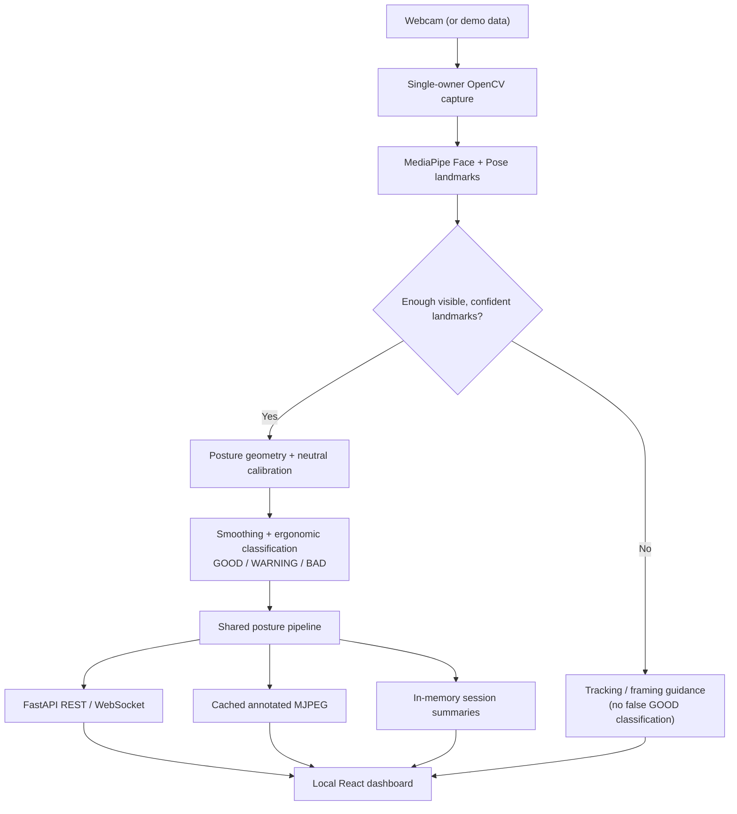
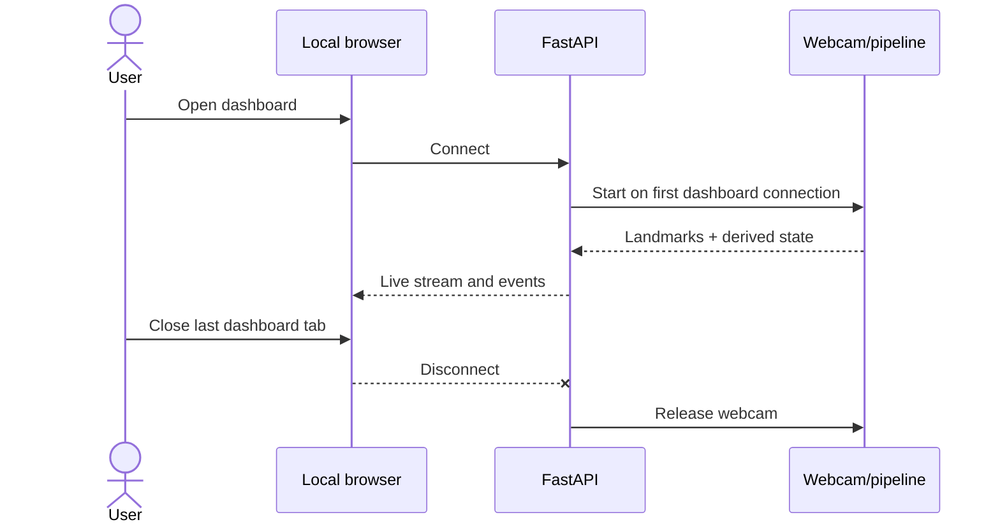
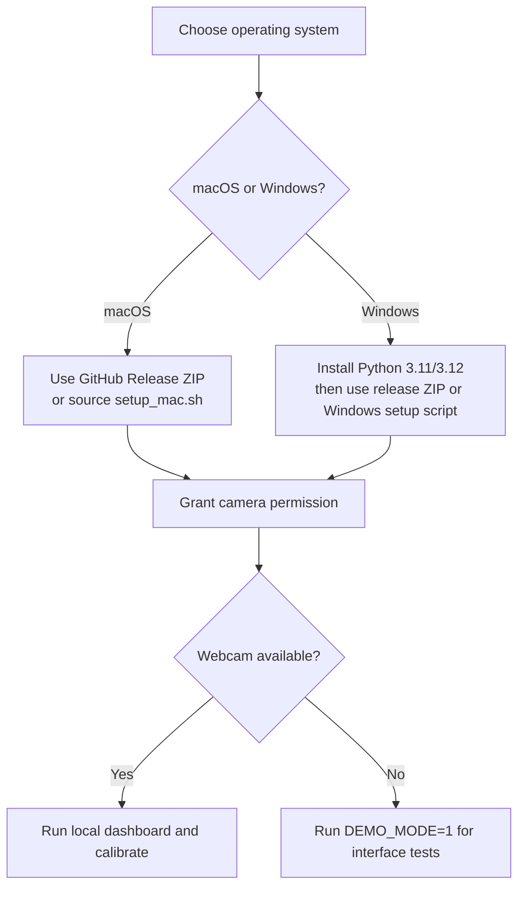
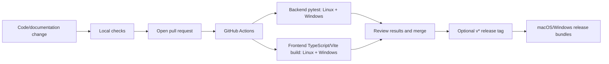

# ErgoVision workflows and visual guide

This guide explains the application's **actual data flow**, its privacy boundary, and practical setup and validation paths. Mermaid diagrams render directly on GitHub.

## 1. Runtime architecture



The backend owns the camera; streaming and other consumers access its cached results rather than competing to capture frames. Classifications are ergonomic indicators, **not medical diagnoses**.

## 2. Camera and privacy lifecycle



Posture processing runs on the host computer. The app does not persist raw webcam footage. Neutral-posture measurements may be stored locally at `~/.ergovision/calibration.json`; browser session summaries may also be retained locally. See [privacy details](PRIVACY.md).

## 3. Installation decision flow



For platform-specific commands use [Installation](INSTALLATION.md), [Windows](WINDOWS.md) and [macOS launcher](MAC_APP.md). **Only install software from sources you trust** and review installation scripts before executing them.

## 4. Contributor validation workflow



Run locally before proposing changes:

```bash
bash scripts/check.sh
```

For individual tasks:

```bash
cd backend
python -m pytest tests/ -v
```

```bash
cd frontend
npm ci
npm run build
```

The CI workflow is in [`.github/workflows/ci.yml`](../.github/workflows/ci.yml). Release packaging is in [`.github/workflows/release.yml`](../.github/workflows/release.yml).

## 5. Demo walkthrough

1. Start in `DEMO_MODE=1` to confirm API/dashboard integration without hardware.
2. Launch with the webcam, confirm browser/OS camera permission, and frame head and shoulders (ideally hips).
3. Calibrate from a neutral upright position and verify the GOOD/WARNING/BAD state changes with posture.
4. Move partly out of frame; verify tracking guidance rather than an undeserved GOOD state.
5. Pause/resume and observe the live trend and session counts.
6. Close every dashboard tab; verify camera release.
7. Report any glitches with OS, Python version, browser, log excerpts, and reproduction steps **without sharing identifiable webcam frames**.

## 6. Known scope boundaries

- Front-facing 2D webcam measurements approximate ergonomic indicators; they do not measure spinal curvature.
- Scores and warning thresholds are not clinically validated diagnostic results.
- Real-time performance depends on computer speed, lighting, camera framing and model availability.
- Desktop notifications require browser permission; demo mode uses simulated data.
- Cross-platform installers and release artifacts should be validated before publishing a tagged release.
